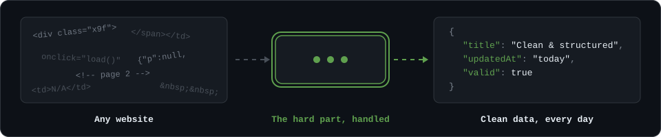

<p align="center">
  
</p>

<p align="center">
  <a href="https://github.com/JKS9">
    
  </a>
</p>

<p align="center">
  
  <a href="https://medium.com/@JKS9"></a>
</p>

## About me

I'm a freelance back-end developer building scalable, high-performance systems with **Node.js**, **NestJS** and the cloud.

**Web scraping is the part of the job I never get tired of.** I love turning messy websites into clean, structured data: headless browsers, dynamic pages, logins, pagination, rate limits, fragile selectors. The trickier the source, the more fun it gets, from a quick one-off script to a fleet of queue-driven workers running every day.

```ts
const me = {
  role: 'Freelance Back-End Developer',
  stack: ['TypeScript', 'Node.js', 'NestJS', 'AWS'],
  loves: 'turning messy websites into clean, structured data',
  writing: 'articles on scraping & queue-driven architectures',
  openTo: ['freelance missions', 'scraping projects', 'API design'],
};
```

## What I do

<table>
  <tr>
    <td width="50%" valign="top">
      <h3>Scraping that holds up</h3>
      <p>I get data out of sites that don't make it easy: logins, JavaScript-heavy pages, pagination, rate limits, fragile selectors. Then I run it on a schedule with queues, retries and alerts, so the data keeps coming long after the first run.</p>
    </td>
    <td width="50%" valign="top">
      <h3>Back ends and APIs</h3>
      <p>Node.js services with NestJS or Express, type-safe APIs with tRPC, documented REST endpoints with OpenAPI, every input validated with Zod.</p>
    </td>
  </tr>
  <tr>
    <td width="50%" valign="top">
      <h3>Data pipelines</h3>
      <p>Moving data from where it lives to where you need it: queue-driven workers on AWS, batch exports to S3, imports from CSV, Excel, PDF or SFTP.</p>
    </td>
    <td width="50%" valign="top">
      <h3>Reliability</h3>
      <p>Deduplication, idempotent jobs, validation at every step, and an alert when a source changes its format, before it breaks anything downstream.</p>
    </td>
  </tr>
</table>

### From a messy website to clean data

<p align="center">
  
</p>

## Tech stack

<p align="center">
  <b>Back-end</b>
  <br />
  
</p>

<p align="center">
  <b>Databases & search</b>
  <br />
  
</p>

<p align="center">
  <b>Cloud & DevOps</b>
  <br />
  
</p>

<p align="center">
  <b>Front-end</b>
  <br />
  
</p>

<p align="center">
  <b>Scraping & more</b>
  <br />
  <code>Playwright</code> <code>Cheerio</code> <code>HTTP & SOCKS proxies</code> <code>tRPC</code> <code>Zod</code> <code>ClickHouse</code> <code>LocalStack</code> <code>MinIO</code> <code>Pino</code>
</p>

<details>
<summary><b>Full toolbox</b></summary>
<br />

| Area | Skills |
| --- | --- |
| **Languages** | JavaScript (ES6+), TypeScript, SQL |
| **Back-end** | Node.js, NestJS, Express, tRPC, REST & OpenAPI (Swagger, Redoc), Zod, JWT authentication |
| **Front-end** | React, Next.js (App Router), Tailwind CSS, Material UI, Redux Toolkit, TanStack Query, React Hook Form, next-intl, Storybook |
| **Databases & search** | MongoDB (Mongoose), MySQL, DynamoDB, ClickHouse, Elasticsearch |
| **Cloud** | AWS (SQS, S3, DynamoDB), Google Cloud (Cloud Storage, Google APIs), Firebase |
| **DevOps** | Docker, Docker Compose, multi-arch builds, Kubernetes, GitLab CI/CD, LocalStack, MinIO, Infisical, Windmill |
| **Data & automation** | Playwright, Cheerio, HTTP & SOCKS proxies, SQS workers (retries, dead-letter queues), ETL & batch exports (S3, JSONL), CSV / Excel / PDF / SFTP processing, cron jobs, email automation (Gmail API, Nodemailer, Brevo) |
| **Architecture** | Microservices, serverless, event-driven & queue-based systems, secure API design, deduplication, idempotency, caching, performance optimization |
| **Quality & ops** | Jest, ESLint, Prettier, Husky & lint-staged, runtime validation & schema drift detection, structured logging & alerting (Pino, Slack), monitoring |
| **Workflow** | Git, GitHub, GitLab, AI-assisted development (Claude Code) |

</details>

## Latest articles

<!-- BLOG-POST-LIST:START -->
- Coming soon on [Medium](https://medium.com/@JKS9)
<!-- BLOG-POST-LIST:END -->

[Read all my articles on Medium](https://medium.com/@JKS9)

## Let's work together

Need data from a tricky source, a scraping pipeline that runs every day, or a solid Node.js back end? I'm available for freelance missions.

<p>
  <a href="https://medium.com/@JKS9"></a>
  <a href="https://github.com/JKS9"></a>
</p>

<p align="center">
  
</p>
