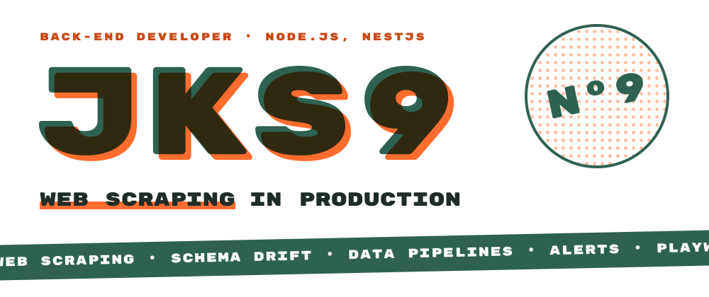
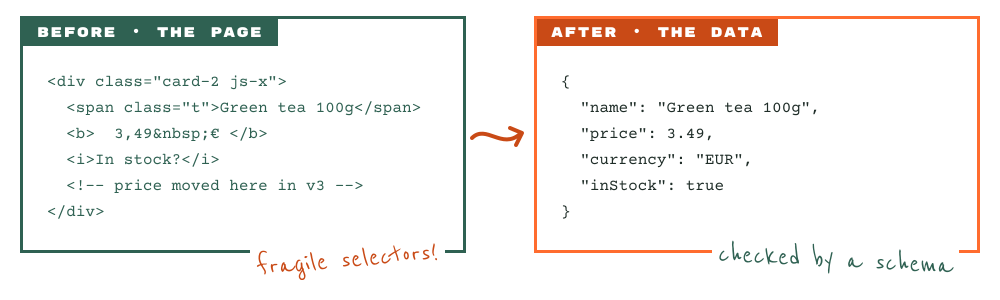

  

## I'm JKS9, a back-end developer specialized in Node.js, NestJS and web scraping.

**Back-end developer · Node.js, NestJS · Web scraping**

**Web scraping is the part of the job I never get tired of.** I turn messy websites into clean, structured data: headless browsers, dynamic pages, logins, pagination, rate limits, fragile selectors. The trickier the source, the more fun it gets, from a quick one-off script to a fleet of queue-driven workers running every day. Around that, I build scalable, high-performance back ends with Node.js, NestJS and the cloud.

### En français

Je suis développeur back-end, spécialisé en Node.js, NestJS et web scraping. J'extrais des données de sites qui ne facilitent pas la tâche (connexion, pages JavaScript, pagination, limites de requêtes) avec Playwright et Cheerio, et je les livre propres et structurées, une fois ou tous les jours. Mes sujets : extraction de données, pipelines sur AWS, API Node.js.

## What I do

<table>
  <tr>
    <td width="50%" valign="top">
      <h3>Web scraping that holds up</h3>
      
I get data out of sites that don't make it easy: logins, JavaScript-heavy pages, pagination, rate limits, fragile selectors. Then I run it on a schedule with queues, retries and alerts, so the data keeps coming long after the first run.

    </td>
    <td width="50%" valign="top">
      <h3>Node.js back ends &amp; APIs</h3>
      
Node.js services with NestJS or Express, type-safe APIs with tRPC, documented REST endpoints with OpenAPI, every input validated with Zod.

    </td>
  </tr>
  <tr>
    <td width="50%" valign="top">
      <h3>Data pipelines &amp; ETL</h3>
      
Moving data from where it lives to where you need it: queue-driven workers on AWS, batch exports to S3, imports from CSV, Excel, PDF or SFTP.

    </td>
    <td width="50%" valign="top">
      <h3>Reliability</h3>
      
Deduplication, idempotent jobs, validation at every step, and an alert when a source changes its format, before it breaks anything downstream.

    </td>
  </tr>
</table>

### From a messy website to clean data

  

## Ingredients

**TypeScript**, **Node.js**, **NestJS**, Express, Jest, Playwright, Cheerio, HTTP & SOCKS proxies, AWS (SQS, S3, DynamoDB), MongoDB, MySQL, ClickHouse, Elasticsearch, Google Cloud, Firebase, Docker, Kubernetes, GitLab CI, tRPC, Zod, Pino, LocalStack, MinIO.

May contain traces of React, Next.js, Tailwind CSS and Redux.

<b>Full toolbox</b>

 

| Area                   | Skills                                                                                                                                                                                                                 |
| ---------------------- | ---------------------------------------------------------------------------------------------------------------------------------------------------------------------------------------------------------------------- |
| **Languages**          | JavaScript (ES6+), TypeScript, SQL                                                                                                                                                                                     |
| **Back-end**           | Node.js, NestJS, Express, tRPC, REST & OpenAPI (Swagger, Redoc), Zod, JWT authentication                                                                                                                               |
| **Front-end**          | React, Next.js (App Router), Tailwind CSS, Material UI, Redux Toolkit, TanStack Query, React Hook Form, next-intl, Storybook                                                                                           |
| **Databases & search** | MongoDB (Mongoose), MySQL, DynamoDB, ClickHouse, Elasticsearch                                                                                                                                                         |
| **Cloud**              | AWS (SQS, S3, DynamoDB), Google Cloud (Cloud Storage, Google APIs), Firebase                                                                                                                                           |
| **DevOps**             | Docker, Docker Compose, multi-arch builds, Kubernetes, GitLab CI/CD, LocalStack, MinIO, Infisical, Windmill                                                                                                            |
| **Data & automation**  | Playwright, Cheerio, HTTP & SOCKS proxies, SQS workers (retries, dead-letter queues), ETL & batch exports (S3, JSONL), CSV / Excel / PDF / SFTP processing, cron jobs, email automation (Gmail API, Nodemailer, Brevo) |
| **Architecture**       | Microservices, serverless, event-driven & queue-based systems, secure API design, deduplication, idempotency, caching, performance optimization                                                                        |
| **Quality & ops**      | Jest, ESLint, Prettier, Husky & lint-staged, runtime validation & schema drift detection, structured logging & alerting (Pino, Slack), monitoring                                                                      |
| **Workflow**           | Git, GitHub, GitLab                                                                                                                                                                                                    |

## Reader questions

### What kind of websites can you scrape?

I scrape websites that don't make it easy: logins, JavaScript-heavy pages, infinite scroll and pagination, rate limits, fragile selectors. I use Playwright for dynamic pages, Cheerio for static HTML, and HTTP or SOCKS proxies when needed.

### A one-off script or something that runs every day?

I build both: a quick one-off script for a single export, or a fleet of queue-driven workers on AWS SQS that run every day, with retries, dead-letter queues and an alert when a source changes.

### What format does the data end up in?

Clean, validated, deduplicated data in the format the project needs: JSON, JSONL, CSV or Excel, delivered to S3, to your database (MongoDB, MySQL, ClickHouse, DynamoDB) or through an API.

### Do you do more than scraping?

Yes. I also build Node.js back ends with NestJS or Express, type-safe APIs with tRPC, REST endpoints documented with OpenAPI, and data pipelines that import CSV, Excel, PDF or SFTP files.

## Latest articles

<!-- BLOG-POST-LIST:START -->

- Coming soon
<!-- BLOG-POST-LIST:END -->

Articles on web scraping in production and queue-driven architectures, coming soon.

## Let's talk scraping

Fighting a tricky source, a pipeline that breaks every week, or a schema that keeps drifting? I'm always happy to talk about web scraping in production.

- Email: [juzans.etienne@gmail.com](mailto:juzans.etienne@gmail.com)
- GitHub: [github.com/JKS9](https://github.com/JKS9)
- LinkedIn: [linkedin.com/in/etienne-juzans](https://www.linkedin.com/in/etienne-juzans)
- Reddit: [u/JKS9_dev](https://www.reddit.com/user/JKS9_dev/)

---

JKS9 · Back-end developer · Node.js, NestJS · Web scraping
